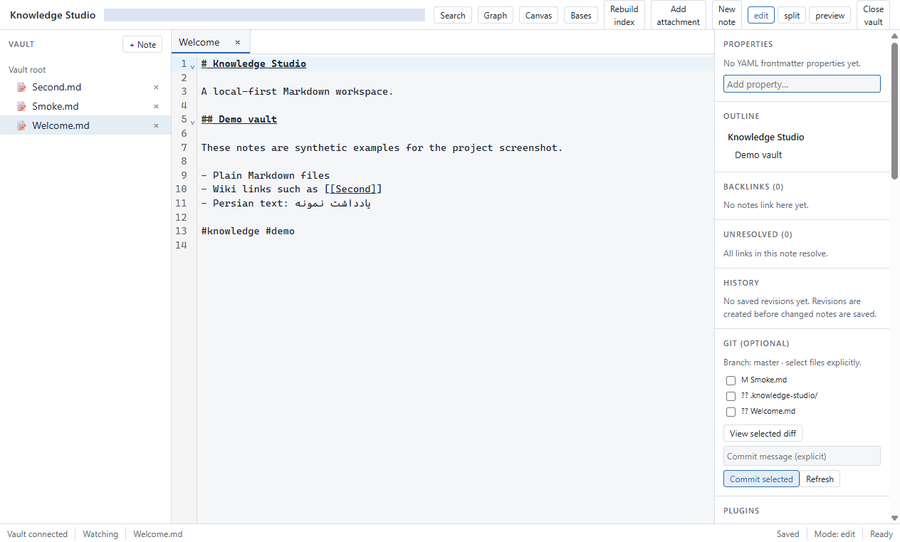

# Knowledge Studio

A local-first, offline-first desktop knowledge workspace built on **plain Markdown files**.
Notes, wiki links, backlinks, graph, search, properties, templates, canvas, and attachments —
with the durable content format always being ordinary files you own and can open with any
editor.

> **Status: Phases 0–37 (Tier 1) implemented.** The desktop shell, vault engine, editor,
> links, metadata, search, graph, templates, plugins, MCP, AI bridge, security/release
> hardening, stable IDs/provenance/change-feed, Bases, Web Clipper, PDF reader with
> annotations, MCP Retrieval V2, and Zotero integration described below are built and
> covered by the test suite. Tier 2 (Second Brain Assistant, memory graph) is future work.

## Release scope and limitations

Tier 1 implementation is complete; the first public release remains **pre-1.0**.
Windows x64 is the current packaging target. macOS and Linux packaging and runtime
acceptance have not been verified for this release.

- Plugin manifest discovery and permission policy are implemented; third-party plugin
  code execution is deferred for security.
- AI provider configuration and OS-backed credential controls are available. The
  provider-neutral bridge does not imply a hosted assistant or bundled AI service.
- Web Clipper imports HTML through the desktop workflow; no browser extension is shipped.
- Zotero supports offline import and configured loopback synchronization.
- Installers are unsigned. Tier 2, cloud sync, mobile, and collaboration are future work.

See [release validation](docs/development/release-readiness.md) and
[UI inventory](docs/development/ui-inventory.md) for boundaries and known limitations.

## Why Knowledge Studio

- **Your files are the product.** Notes are Markdown; attachments are normal files; the
  SQLite index is a disposable, rebuildable cache. Delete the index and nothing is lost.
- **Local-first and offline-first.** No account, no telemetry, no hidden network requests.
  AI features are optional, off by default, and provider-neutral.
- **Portable by design.** Cross-platform path validation so a vault moves safely between
  Windows, macOS, and Linux (including Persian filenames).
- **AI-ready without lock-in.** A read-only local MCP server and provider-neutral AI
  bridge are built in; the core product works with zero AI configured.

## Roadmap

| Phase          | Scope                                                                           | Status |
| -------------- | ------------------------------------------------------------------------------- | ------ |
| 0              | Workspace foundation: tooling, gates, ADRs, desktop shell                       | ✅     |
| 1              | Vault engine (atomic IO, traversal guards, watcher, trash)                      | ✅     |
| 2              | Markdown editor (tabs, explorer, properties, outline)                           | ✅     |
| 3              | Wiki links, backlinks, rename-aware updates                                     | ✅     |
| 4              | Metadata: YAML frontmatter, typed properties panel                              | ✅     |
| 5              | Search: filename + SQLite FTS5, incremental index, rebuild                      | ✅     |
| 6              | Backlinks index + knowledge graph                                               | ✅     |
| 7              | Tags, outline                                                                   | ✅     |
| 8–12           | Templates, attachments, command palette, workspaces, canvas                     | ✅     |
| 13–18          | History, optional Git, plugins, MCP, AI bridge, semantic search                 | ✅     |
| 19–29          | Security hardening, import/export, RTL/Persian, performance, release            | ✅     |
| 30             | Stable vault and document IDs                                                   | ✅     |
| 31             | Provenance / citation source model                                              | ✅     |
| 32             | Durable cursor change feed                                                      | ✅     |
| 33             | Bases: trusted host, views, Kanban                                              | ✅     |
| 34             | Web Clipper: offline ingestion with provenance                                  | ✅     |
| 35             | PDF reader with annotations and cited export                                    | ✅     |
| 36             | MCP Retrieval V2: cited passages, hardened transport                            | ✅     |
| 37             | Zotero integration: offline import, loopback sync                               | ✅     |
| Tier 1 closure | Integration/integrity diagnostics, renderer navigation and permission hardening | ✅     |

Tier 2 (Second Brain Assistant, memory graph / relationship explorer upgrades, advanced
personalization, Sync/Mobile/Collaboration) is proposed/future work only — not started.

## Screenshot



Actual Windows development build with synthetic demo notes. The local vault path
is masked for privacy; no user content is shown.

## Repository layout

```
KnowledgeStudio/
├── apps/desktop/          Electron shell + React renderer
├── packages/              Domain packages (shared, vault, search, bases, ...)
├── tests/                 Cross-package integration and e2e tests
├── docs/                  Architecture, ADRs, development and security docs
└── scripts/               Repository tooling
```

See [ARCHITECTURE.md](ARCHITECTURE.md) for the full design and
[docs/adr/](docs/adr/) for the reasoning behind major decisions.

## Development

Prerequisites: Node.js ≥ 22.13 and pnpm (enable with `corepack enable pnpm`, or run pnpm via
`corepack pnpm …` directly). Corepack must be available; see the
[setup guide](docs/development/setup.md) if your Node distribution does not include it.

```bash
corepack pnpm install --frozen-lockfile # install pinned workspace dependencies
corepack pnpm typecheck    # build TypeScript declarations first (required on a fresh clone)
corepack pnpm lint         # ESLint
corepack pnpm test         # Vitest
corepack pnpm build        # build all packages
corepack pnpm dev          # run the desktop app in dev mode
```

Every commit is expected to pass lint, typecheck, and tests. See
[CONTRIBUTING.md](CONTRIBUTING.md) for conventions.

## License

Knowledge Studio code is MIT-licensed; see [LICENSE-NOTICE.md](LICENSE-NOTICE.md) for the
license statement and third-party dependency notices. The standard license is in [LICENSE](LICENSE).
